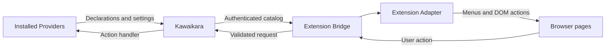

# Architecture

[Documentation](Index.md) · [Connection](Connection.md)

## Responsibilities

Providers declare action IDs, menus, DOM insertion recipes, permissions, and boolean
settings. Kawaikara mediates these declarations and dispatches actions to the Provider's
`static onWebExtensionAction` or a common app handler.

The extension has two responsibilities:

- **Bridge:** pairing, authenticated discovery/reconnection, catalog synchronization,
  settings requests, and app wake requests.
- **Adapter:** generic menus, DOM rendering, and permitted browser effects based on
  Provider declarations and user grants.

The extension bundles no default Provider list or site-specific execution code. Shared
link generation and application behavior belong to Kawaikara/Providers. Declarations
are validated data, not arbitrary remote JavaScript or HTML.

## Settings, permissions, and cache

Kawaikara owns Provider settings and grants. Enable a Provider in the draft before editing its
settings, then apply the batch from the fixed footer. Connecting alone does not enable any Provider. Declared capabilities and
browser host permissions both constrain features. Unknown commands, settings, and
executable fields are rejected by the shared contract.

The extension caches the last authenticated catalog and settings under the current
connection credentials. Approved menus and DOM actions survive worker restarts and
app downtime, subject to browser host permissions. Action execution still requires
reconnection and current authorization. Disconnect removes local credentials and cache,
including while offline; it does not claim that app settings were saved.

## Settings UI

The React options page uses KawaiUI Panel, Button, Switch, Input, and Badge components.
It supports system light/dark appearance, narrow windows, Provider searches by name,
ID, and domain, permission tags, and conditional Connect/Disconnect controls.

Connection status is shown with text and color: green for connected, yellow for checking
or an offline linked app, and red for disconnected. Toolbar badges show `LINK` (connect),
`SET` (enable a Provider), `ON` (active), or `!` (error).

The app-information dialog shows authenticated desktop name, version, channel, runtime,
app path, profile ID, and bridge address. Offline information is labeled as cached.
Tokens are excluded from the UI and public discovery responses. Older apps can have
missing metadata.

## SPA document validation

After navigation without a page reload, a message sender URL may describe an older
page than the current tab. Content scripts send a random document key and the URL at
click time. The worker challenges the current top frame and verifies its document key,
URL, and origin before dispatch, including a recheck after catalog synchronization.
A replaced document or stale click is rejected.

Errors appear as a separate five-second notification and never replace Provider menu
titles. Reload existing site tabs after updating content scripts.

The desktop checkout also documents the shared contract and architecture in
`docs/Developer/i18n/ko/Architecture/9.ProviderWebExtension.md`.

## Browser execution boundary

Provider count and action IDs remain extensible. Browser capabilities do not:
new browser operations require an extension release, not a Provider declaration.
The packaged adapter renders only `menu-item` and `button-list` descriptors.
Selectors locate containers; they do not extract page text, input values, cookies,
or credentials. Labels use text nodes, never Provider-supplied HTML or JavaScript.
Insertion into document roots, editable fields, interactive controls and executable
containers is rejected. Cleanup removes only nodes created by the adapter.
The optional `close` selector can only identify the activated menu or an ancestor
at most two levels above it. It must contain the clicked adapter item, remain
connected, fit within a small menu-sized area, and contain no video, input or
embedded page. Document roots and structural page regions are rejected. After a
successful trusted action, the adapter temporarily hides this container and
restores its own display override on the next trusted interaction or cleanup.
It does not overwrite intervening site changes. All inserted entries carry the
packaged Kawaikara image; Providers cannot replace that identity. Firefox supports
individual native-menu icons; Chrome uses the manifest icon for its extension menu.

Actions require trusted user input and the existing Provider/domain/grant/revision
checks. The desktop accepts only the optional declared `clipboard` result from a
Provider. The browser accepts only `{ ok: true, clipboard?: string }`; unknown keys,
non-string or over-16,384-character clipboard values, and undeclared clipboard
effects are rejected. There is no response command interpreter, arbitrary script,
HTML, URL navigation, or DOM mutation result. Desktop Provider execution is a
separate trust boundary; this contract does not sandbox native Provider code.

Permission expansion still requires fresh approval. Cached declarations do not
add capabilities. These limits make behavior inspectable; they do not guarantee
store approval.

## Provider label resources

Built-in Provider UI labels live in the desktop Provider's `locale.json`. Their
manifest `title` fields reference `%webExtension.…%` keys. Kawaikara resolves
these references before sending a catalog; the extension receives plain fallback
text and validated translations, never local filesystem paths or unresolved keys.
Context menus, DOM entries, action summaries and settings share exact-locale,
base-language and fallback resolution. The options page uses its selected language
for action summaries and settings. Inline translations remain an optional contract
feature for third-party Providers, rather than the built-in authoring convention.
